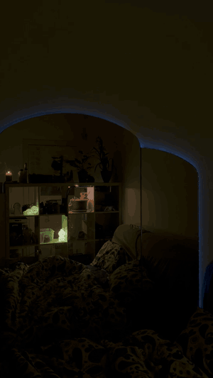

# specchio-fw

Firmware that turns a cheap AliExpress HomeKit LED strip controller, almost unusable behind a bedroom mirror, into a light that stays reachable, wakes you with a sunrise and plays storms with sound.

Custom firmware for the **Athom LS5050C(-HK) RGB strip controller** (ESP8266), plus Mac tools that play
light scenes with sound on it. It replaces Athom's HomeKit firmware v0.8.5.

"Specchio" is Italian for mirror: the strip lives behind a bedroom mirror, far from the router.
The stock firmware answered late and dropped off the network; this one was written from measurements.

<!-- Photos and video go here: the controller board, the strip behind the mirror,
     a thunderstorm scene, the orange blink when Claude Code finishes.
      -->

## What it does

In the controller, with no other computer running:

- **HomeKit** light (on/off, brightness, hue, saturation) and a switch for every mode.
- **Wake-up light**: sunrise 30 minutes before the alarm, full light at the alarm, growing blinks
  10 minutes later until you stop it. The alarm time comes from the phone (`docs/comando-rapido-iphone.md`, in Italian)
  or from the page at `/`.
- **Modes**: Alba (sunrise), Focus (a timer from green to red), Vibrazione (the idle lamp is never perfectly
  still), Orologio (two blinks at every change of hour).
- **Event blinks** over whatever is showing (`/api/flash`), used for example when Claude Code finishes.
- **Wi-Fi that stays reachable** on a weak signal: no modem sleep, continuous reconnect, a rest in the main
  loop, and a scan every 30 minutes for a stronger access point of the same network.
- **Cannot-brick measures**, since no serial port is wired:
  - three unrequested reboots in a row -> safe mode (lamp, web page and `/update` still work);
  - 5 minutes offline -> setup access point `specchio-setup` (password = `OTA_PASS`) at http://192.168.4.1;
  - **self-restore**: a known-good image is kept at the top of flash; an update that cannot be reached within
    4 minutes is replaced by it through the bootloader (`src/guard.cpp`, `tools/try_fw.sh`);
  - button: short = toggle, 5 s = setup access point, 15 s = factory reset.

From a Mac on the same network (`tools/`, macOS only, experimental):

- **Scenes with sound** (`tools/scenes.py`): thunderstorms from real recordings where the light follows the
  loudness of the thunder, earthquakes as they happen, the colour of far-away webcams, the flag of the country
  the planes overhead fly to.
- **Experimental, not yet tried on the real light** (run only against `tools/fake_strip.py`, with sound muted):
  - **Stormy sea** (`temporale mare`): surf and gale recordings, the light swells with the waves;
  - **Place** (`luogo <name>`): the sky over any named place right now (sun height, clouds, wind, rain, storms),
    with dawn and dusk replays;
  - **Sun** (`sole`): the Sun's X-ray activity, live or the last six hours;
  - **Sleep** (`sonno`): a dim breath-paced light and rain that fade to dark.
- **Air quality** from a Xiaomi purifier read on the local network (`tools/purifier.py`): the lamp keeps its light
  and blinks a colour when dust or humidity pass a limit.
- **Home app switches** for the scenes: Temporale, Mare in tempesta, Sole, Sonno, Aria, Terremoti,
  Posto lontano, Aerei. The strip holds the switch, `scenes.py casa` on the Mac plays the scene; scenes that
  drive the light exclude each other, and a wake-up always wins over any of them.
- **"Luogo" in the Home app is a television whose inputs are six places**: turning it on shows the sky over the
  chosen place, picking another input changes place, and renaming an input in the Home app (TV settings) makes
  the new name the new place. The names live on the strip (`/places.txt`, `/api/places`).
- **A globe on the phone** to fill those six places: `scenes.py casa` serves it at
  `http://<mac-name>.local:8765`. Pick a slot, turn the globe, tap a point or search a name; it shades the night
  side of the Earth as it is right now.

## Measured: before and after

In short, stock firmware against 2.7.1 at about -90 dBm:

- pings slower than 50 ms: 27% before, 3-4% now;
- slowest HTTP answer: about 1 s before, 265 ms now (65 ms in the one quieter 2.1.0 session);
- 900 of 900 commands answered in a row, with rare answers as slow as 2.5 s. The stock firmware was never put
  through this test; the "19 of 90 lost" figure below comes from this firmware with its main loop spinning.

The "before" numbers are **one session only**: the stock firmware cannot be reinstalled to measure it again.

Same Mac, same place, 200 pings and 40 HTTP requests per session (`tools/bench.py`), strip at about -90 dBm.

| | Stock Athom 0.8.5 | specchio-fw 2.1.0 | specchio-fw 2.7.1 |
|---|---|---|---|
| Sessions | 1 | 1 | 3 (mean, worst) |
| Ping, median | 9 ms | 8 ms | 6 ms, 6 ms |
| Ping, 95th percentile | 155 ms | 13 ms | 27 ms, 33 ms |
| Ping, slowest | 219 ms | 19 ms | 442 ms, 820 ms |
| Pings slower than 50 ms | 27% | 0% | 3.4%, 4% |
| Pings lost | 0 of 200 | 0 of 200 | 5 of 600, worst 3 of 200 |
| HTTP, median | 52 ms | 32 ms | 31 ms, 32 ms |
| HTTP, 95th percentile | 365 ms | 50 ms | 54 ms, 60 ms |
| HTTP, slowest | 1028 ms | 65 ms | 126 ms, 265 ms |
| 300 commands in a row | not measured | not measured | 900 of 900 answered, slowest 2.5 s |

The 2.7.1 sessions ran back to back in one night at -91/-92 dBm while a helper polled the strip every
2 seconds; the 2.1.0 column is one quieter session. The gap between those two columns is within what a single
session can hide, so read them as "a few percent of slow pings, no lost commands", not as a regression.

The "before" column is **a single session**, and the stock firmware cannot be measured again: Athom does not
publish it, so there is no way back. Raw outputs are in `docs/`.

One line in the main loop mattered more than expected. With the same binary and the same signal
(`docs/loop-rest.txt`):

| Main loop | Requests answered | Worst answer |
|---|---|---|
| spinning, about 22,000 passes a second | 71 of 90 | 2.67 s |
| resting 1 ms per pass, about 940 a second | 90 of 90 | 0.09 s |

Why a spinning loop makes the radio deaf on this board is not established; the measurement is.

Still open: after a restart the strip can stay unreachable from one particular Mac for 100-180 s although it
has rejoined the router within seconds. Cause unknown.

## Supported hardware

- **Athom LS5050C-HK** RGB strip controller: ESP8266, 2 MB flash (DOUT), no serial header populated.
- PWM on GPIO12, GPIO4, GPIO14; button on GPIO0; a spare MOSFET on GPIO13 (held low).
- Which GPIO is red or green differs between board revisions: check with `/api/raw`, fix with `/api/config?pins=`.
- Tested on **one unit**. Other Athom ESP8266 RGB controllers may work with other pins; none were tried.

## Configure without putting secrets in the repository

Wi-Fi name and password, the HomeKit pairing code and the update password are compiled in from `secrets.ini`,
which git ignores:

    cp secrets.example.ini secrets.ini     # then edit the four values

- `WIFI_SSID` / `WIFI_PASS` are used only until the strip has joined once; later they can be changed with
  `POST /api/wifi` or from the setup access point.
- `HOMEKIT_CODE` is the code you type in the Home app (format `XXX-XX-XXX`).
- `GOOD_FW_MD5` (optional) is the md5 of the known-good image the self-restore guard may install.
- `OTA_PASS` protects `/update`, `/api/config` and the setup access point.

**Never commit or share a built `firmware.bin`**: it contains those four values. `.gitignore` excludes `*.bin`.

The Mac tools take what belongs to one home (the strip's address, the coordinates for the planes scene) from
`tools/local.json`, also ignored by git:

    cp tools/local.example.json tools/local.json     # then edit

Without it they look for the strip at `specchio.local`. The serial number shown in the Home app is the chip's
own id, read at start-up: nothing of a single device is written in the source.

## Build, test, flash

    pio run
    for t in color policy effects; do c++ -std=c++11 -Wall -Isrc test/test_$t.cpp -o /tmp/t && /tmp/t; done
    python3 tools/scenes.py check

First flash, from the stock Athom firmware. **This cannot be undone**: there is no copy of the stock firmware
to go back to.

    curl -F file=@.pio/build/specchio/firmware.bin http://<strip-address>/update

Later updates, from this firmware:

    curl -u admin:$OTA_PASS -F firmware=@.pio/build/specchio/firmware.bin http://<strip-address>/update

`tools/try_fw.sh` does the same with the self-restore guard in place and reports whether the new firmware
joined or was rolled back; it needs a known-good image stored first (see the header of `src/guard.cpp`).
The tools read the strip's address from `tools/local.json`, or take it with `--host` / `HOST=`.

Then add the accessory in the Home app with your `HOMEKIT_CODE`.

## API

Open on the local network:

    GET /api/state                           everything, as JSON
    GET /api/log
    GET /api/set?on=1&hex=ff8000&v=60        also h=0-360, s=0-100
    GET /api/raw?r=1023&g=0&b=0              direct PWM duty (scenes, wiring tests); refused during a wake-up
    GET /api/effect?name=alba&minutes=20     alba, focus; name=off stops
    GET /api/flash?hex=ff8000&n=3            coloured blinks over whatever is showing
    GET /api/wake?at=07:30                   or a POST with any text containing times; stop=1, off=1, ring=1
    GET /api/scene?name=temporale&on=1       flips the Home switch of a scene the Mac plays
    GET /api/places?slot=3&name=Tokyo&chosen=1   rename and/or choose one of the six "Luogo" places
    GET /api/set?shimmer=30&hourly=1&claude=1
    GET /api/roam                            look for a better access point now

Password protected (`admin` / `OTA_PASS`): `/api/config` (pins, PHY mode, boot state, fade, TX power),
`POST /api/wifi`, `POST /api/reboot`, `POST /api/factory-reset`, `/update`, `/api/stash`, `/api/restore`.

## Blink when Claude Code finishes

Add a `Stop` hook to `~/.claude/settings.json`:

    "hooks": { "Stop": [ { "hooks": [ {
      "type": "command", "async": true, "timeout": 5,
      "command": "curl -s -m 2 'http://<strip-address>/api/flash?hex=ff8000&n=3&src=claude' >/dev/null 2>&1 || true"
    } ] } ] }

Blinks tagged `src=claude` are shown only while the "Claude" switch in the Home app is on.

## Mac tools

    python3 tools/scenes.py                  # menu
    python3 tools/scenes.py temporale film   # real rain and thunder, until stopped
    python3 tools/scenes.py luogo Tokyo      # the sky over Tokyo now
    python3 tools/scenes.py casa             # follow the scene switches of the Home app, serve the globe
    tools/install_autostart.sh               # the same, started with the Mac (remove: install_autostart.sh remove)
    tools/prova_scene.sh mare                # one scene in 45 s, to film it: temporale, mare, luogo, sole, sonno
    python3 tools/fake_strip.py              # a stand-in strip, to try scenes without hardware
    python3 tools/bench.py <strip-address>   # the measurements above

`install_autostart.sh` runs the helper from a copy in `~/Library/Application Support/specchio`: a program
started at login may not read Desktop or Documents without a click on a privacy prompt, and macOS keeps a Python
started directly by launchd off the local network, so the service starts it through `osascript`. Run the script
again after changing the tools; your `local.json` and `purifier.json` in the copy are kept.

Scenes need `ffmpeg` and use macOS programs (`afplay`, `sips`). Recordings are downloaded once from Wikimedia
Commons; nothing is stored in this repository. Author and licence of each are in `tools/sounds.json` and are
printed when it plays.

## Data and credits

Code:

- This project: MIT, see `LICENSE`.
- [HomeKit-ESP8266](https://github.com/Mixiaoxiao/Arduino-HomeKit-ESP8266) by Mixiaoxiao (MIT), used unmodified
  as a dependency.
- ESP8266 Arduino core 2.7.4 (LGPL-2.1).
- The Xiaomi sign-in in `tools/xiaomi_login.py` follows the protocol documented by
  [Xiaomi-cloud-tokens-extractor](https://github.com/PiotrMachowski/Xiaomi-cloud-tokens-extractor) (MIT).
  It uses an unofficial interface of the Mi Home cloud.

Live data. Nothing is stored or redistributed: pictures are reduced to one mean colour, numbers to a light.
The terms below were read on 12 November 2026; check them again before building on these services.

- **[GeoNet](https://www.geonet.org.nz/policy)** (New Zealand volcano cameras): GNS Science states GeoNet content
  is under Creative Commons Attribution 3.0 New Zealand and asks for this acknowledgement: "We acknowledge the
  New Zealand GeoNet programme and its sponsors NHC, GNS Science, LINZ, NEMA and MBIE for providing data/images".
  The full data policy page was not read: confirm it covers camera images before any other use.
- **[adsb.lol](https://github.com/adsblol/api)** (planes near a point): a community network. The public API needs
  no key today and its rate limits are "dynamic"; the maintainers announce that a key, given to people who feed
  data, will be required in the future. No terms of use for the public API were found; their published datasets
  are under ODbL 1.0. The planes scene asks once every 30 seconds.
- **[adsbdb](https://www.adsbdb.com)** (route of a flight): a public API. Stated limits: 512 requests bring a
  60-second block, 1024 a 300-second block. It credits PlaneBase and airport-data for its own data. No licence
  was found. The planes scene asks once per new callsign.
- **USGS** (earthquake feed, Hawaiian volcano cameras), **NOAA** (GOES X-ray flux and satellite images),
  **NASA SDO**, **US National Park Service**: works of US federal agencies, in the public domain in the United
  States; they ask to be credited.
- **[Open-Meteo](https://open-meteo.com)** (place names, weather): data under CC BY 4.0, free for non-commercial use.
- **flagcdn**, **miot-spec.org**: flag pictures and Xiaomi's public device descriptions.

Recordings: Wikimedia Commons contributors. Each file's author and licence (public domain, CC0, CC BY, CC BY-SA)
is in `tools/sounds.json` and is printed when it plays. Files are downloaded to a local cache on first use.

## Built with Claude Code

I led the project: what to build, what to measure, what to keep, and every decision along the way.
The code, the tests and the measurement scripts were written by Claude Code (Anthropic) under that direction.
